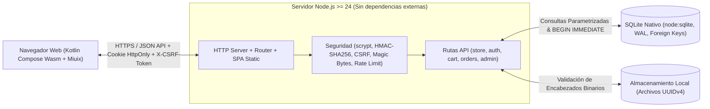
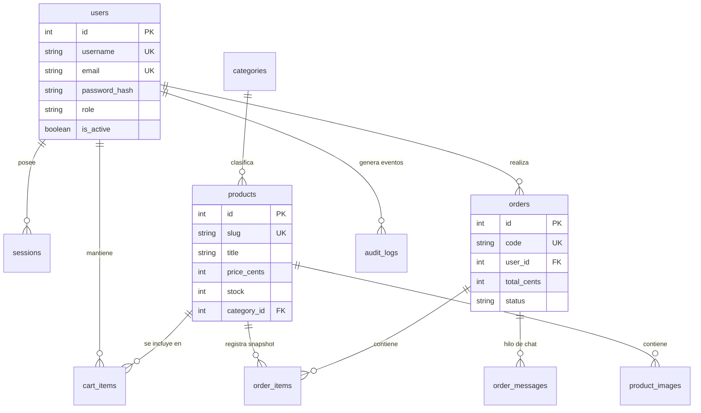

# TBD.SUPPLY

Sistema e-commerce full-stack desarrollado con **Kotlin / Compose Multiplatform (WebAssembly)** en el cliente y **Node.js (>= 24) + SQLite** en el servidor, implementado exclusivamente con módulos nativos (cero dependencias de terceros en el backend).

[](https://github.com/MituOS2/TBD-Supply/actions/workflows/ci.yml)
[](LICENSE)
[](https://nodejs.org/)
[](https://kotlinlang.org/docs/wasm-overview.html)
[](https://nodejs.org/api/sqlite.html)

---

## Tabla de Contenidos

- [Características Principales](#características-principales)
- [Arquitectura y Stack Técnico](#arquitectura-y-stack-técnico)
- [Estructura del Proyecto](#estructura-del-proyecto)
- [Inicio Rápido](#inicio-rápido)
- [Despliegue en Render](#despliegue-en-render)
- [Desarrollo Manual](#desarrollo-manual)
- [Variables de Entorno](#variables-de-entorno)
- [Referencia de API REST](#referencia-de-api-rest)
- [Esquema de Base de Datos](#esquema-de-base-de-datos)
- [Seguridad](#seguridad)
- [Pruebas Automatizadas](#pruebas-automatizadas)
- [Licencia](#licencia)

---

## Características Principales

### Tienda Web (Frontend Wasm)
- **Interfaz compilada a WebAssembly:** UI nativa desarrollada en Kotlin / Compose Multiplatform (`wasmJs`) con el sistema de componentes [Miuix](https://github.com/compose-miuix-ui/miuix).
- **Layout Adaptable:** Ajuste entre navegación inferior para pantallas pequeñas (`< 840 dp`) y riel lateral para pantallas grandes (`>= 1180 dp`).
- **Catálogo y Carrito:** Búsqueda, filtrado por categorías, gestión de carrito persistente con sincronización de sesión (`/api/cart/merge`) y checkout en centavos USD.
- **Soporte y Chat por Pedido:** Hilo de mensajes cliente-administrador integrado en cada orden con soporte para adjuntar imágenes (`PNG`, `JPEG`, `WebP`).

### Panel de Administración
- **Dashboard y Métricas:** Resumen de catálogo, pedidos, inventario y usuarios.
- **Gestión CRUD:** Administración de productos, categorías, imágenes de catálogo (portada y galería), estados de pedidos y usuarios.
- **Auditoría:** Registro inmutable de eventos del sistema (`audit_logs`) y revocación remota de sesiones.

---

## Arquitectura y Stack Técnico



| Componente | Tecnología | Notas |
| :--- | :--- | :--- |
| **Frontend** | Kotlin `2.4.21` + Compose Wasm `1.12.2` | Target `wasmJs`, `kotlinx-serialization` |
| **UI Kit** | [Miuix](https://github.com/compose-miuix-ui/miuix) (`vendor/miuix`) | Incluido vía Composite Build de Gradle |
| **Backend** | Node.js `>= 24.0.0` (ESM) | Módulos nativos (`node:http`, `node:sqlite`, `node:crypto`, `node:zlib`) |
| **Base de Datos** | SQLite (`node:sqlite`) | Modo `WAL`, `PRAGMA foreign_keys = ON`, transacciones `BEGIN IMMEDIATE` |
| **Pruebas** | `node:test` + `node:assert/strict` | Pruebas de integración e inspección de seguridad |

---

## Estructura del Proyecto

```text
TBD-Supply/
├── .github/
│   ├── workflows/ci.yml         # Pipeline CI para ejecución de pruebas
│   └── PULL_REQUEST_TEMPLATE.md # Plantilla para Pull Requests
├── gradle/
│   └── libs.versions.toml       # Versiones centralizadas de dependencias
├── scripts/
│   ├── bootstrap.ps1            # Instalación y compilación en Windows
│   └── bootstrap.sh             # Instalación y compilación en Linux/macOS
├── server/
│   ├── data/                    # Archivo de base de datos SQLite (store.sqlite)
│   ├── storage/uploads/         # Almacenamiento local de imágenes
│   ├── dist-web/                # Distribución compilada del frontend WebAssembly
│   ├── src/
│   │   ├── db/                  # Esquemas, migraciones y datos iniciales
│   │   ├── http/                # Servidor HTTP nativo y enrutador
│   │   ├── middleware/          # Sesiones, CSRF y control de acceso (RBAC)
│   │   ├── routes/              # Endpoints API (auth, store, cart, orders, admin)
│   │   ├── security/            # scrypt, HMAC, validación de archivos y rate limiting
│   │   ├── utils/               # Bitácora de auditoría y anonimización de IP
│   │   ├── app.js               # Configuración del servidor y servicio estático SPA
│   │   ├── config.js            # Carga y validación de variables de entorno
│   │   └── index.js             # Punto de entrada de la aplicación
│   └── tests/
│       ├── integration.test.js  # Pruebas integrales de API y flujos
│       └── security.test.js     # Pruebas de seguridad contra vulnerabilidades
├── webApp/
│   └── src/
│       ├── commonMain/kotlin/   # Código fuente de UI y lógica de cliente
│       └── webMain/             # Punto de entrada WebAssembly y recursos web
├── .env.example                 # Plantilla de variables de entorno
├── CHANGELOG.md                 # Registro de cambios
├── CONTRIBUTING.md              # Guía de contribución
├── LICENSE                      # Licencia del proyecto
├── SECURITY.md                  # Política y controles de seguridad
├── iniciar.bat                  # Script de inicio rápido (Windows)
├── iniciar-publico.bat          # Script de inicio con túnel Cloudflare (Windows)
└── iniciar.sh                   # Script de inicio rápido (Linux/macOS)
```

---

## Inicio Rápido

### Requisitos Previos
- **Node.js `>= 24.0.0`**
- **JDK `21+`**
- **Git**

### Windows
Ejecutar desde terminal o haciendo doble clic:
```cmd
iniciar.bat
```
Para exponerlo mediante un túnel público de Cloudflare:
```cmd
iniciar-publico.bat
```

### Linux / macOS
```bash
chmod +x iniciar.sh scripts/bootstrap.sh
./iniciar.sh
```

### Opciones CLI
| Bandera | Descripción |
| :--- | :--- |
| `-Tunnel` / `--tunnel` | Inicia un túnel público de Cloudflare (`https://*.trycloudflare.com`). |
| `-Rebuild` / `--rebuild` | Recompila el frontend WebAssembly omitiendo la caché. |
| `-BuildOnly` / `--build-only` | Compila el frontend Wasm y finaliza sin iniciar el servidor HTTP. |
| `-CheckOnly` / `--check-only` | Verifica las dependencias del entorno. |
| `-NoBrowser` / `--no-browser` | Inicia el servidor sin abrir el navegador. |

---

## Despliegue en Render

El proyecto incluye un `Dockerfile` multietapa y una plantilla `render.yaml` para despliegue automático en [Render](https://render.com).

### Pasos para desplegar:
1. Entra a tu cuenta en [Render Dashboard](https://dashboard.render.com).
2. Haz clic en **New +** y selecciona **Blueprint**.
3. Conecta tu repositorio de GitHub `MituOS2/TBD-Supply`.
4. Render detectará automáticamente el archivo `render.yaml` y creará el servicio web Docker con compilación del frontend WebAssembly y persistencia SQLite.
5. Haz clic en **Apply** y tu tienda estará desplegada y accesible en tu subdominio de `.onrender.com`.

---

## Desarrollo Manual

```bash
# 1. Configurar variables de entorno
cp .env.example .env

# 2. Inicializar la base de datos SQLite y usuario administrador
npm run seed

# 3. Compilar el frontend WebAssembly
./gradlew :webApp:wasmJsBrowserDistribution -Prelease --no-configure-on-demand
cp -R webApp/build/dist/wasmJs/productionExecutable/. server/dist-web/

# 4. Iniciar el servidor backend
npm run dev
```

### Scripts `npm`
| Comando | Descripción |
| :--- | :--- |
| `npm start` | Inicia el servidor HTTP en modo producción. |
| `npm run dev` | Inicia el servidor con recarga automática (`--watch`). |
| `npm run seed` | Aplica migraciones y datos iniciales en SQLite. |
| `npm test` | Ejecuta las pruebas de integración y seguridad. |
| `npm run test:security` | Ejecuta únicamente las pruebas de seguridad. |

---

## Variables de Entorno

| Variable | Valor por Defecto | Descripción |
| :--- | :--- | :--- |
| `PORT` | `3000` | Puerto de escucha del servidor HTTP. |
| `HOST` | `127.0.0.1` | Dirección IP de escucha. |
| `NODE_ENV` | `development` | Entorno de ejecución (`development` / `production`). |
| `DB_PATH` | `server/data/store.sqlite` | Ruta del archivo de base de datos SQLite. |
| `UPLOAD_DIR` | `server/storage/uploads` | Directorio de almacenamiento de imágenes. |
| `DIST_WEB_DIR` | `server/dist-web` | Directorio con los archivos WebAssembly compilados. |
| `SESSION_PEPPER` | *(Autogenerado)* | Clave secreta HMAC para tokens de sesión. |
| `IP_HASH_SALT` | *(Autogenerado)* | Sal criptográfica para anonimizar direcciones IP. |
| `ADMIN_BOOTSTRAP_USER` | `admin` | Usuario administrador inicial. |
| `ADMIN_BOOTSTRAP_EMAIL` | `admin@tbdsupply.local` | Correo del administrador inicial. |
| `ADMIN_BOOTSTRAP_PASSWORD` | *(Autogenerado)* | Contraseña del administrador inicial. |
| `ALLOWED_ORIGINS` | `""` | Orígenes adicionales permitidos para validación CSRF. |
| `TRUST_PROXY` | `false` | Habilitar si se opera tras un reverse proxy (`X-Forwarded-*`). |
| `COOKIE_SECURE` | `false` | Atributo `Secure` para la cookie de sesión. |
| `LOCAL_AUTO_ADMIN` | `true` | Inicio de sesión admin automático en `localhost`. Ajustar a `false` en producción. |

---

## Referencia de API REST

Las peticiones `POST`, `PUT`, `PATCH` y `DELETE` requieren validación de origen y la cabecera `X-CSRF-Token`.

### Públicos
- `GET /api/health` — Estado del servidor.
- `GET /api/categories` — Lista de categorías y conteo de productos.
- `GET /api/products` — Catálogo de productos (parámetros: `q`, `category`, `founder`, `sort`, `page`, `limit`).
- `GET /api/products/:slug` — Detalle de producto y galería.
- `GET /api/media/:key` — Entrega de imágenes con sandbox CSP.

### Autenticación
- `GET /api/auth/me` — Datos del usuario autenticado y token CSRF.
- `POST /api/auth/register` — Registro de cliente.
- `POST /api/auth/login` — Inicio de sesión.
- `POST /api/auth/logout` — Cierre de sesión actual.
- `POST /api/auth/logout-all` — Revocación de todas las sesiones del usuario.
- `POST /api/auth/change-password` — Cambio de contraseña.

### Carrito y Pedidos
- `GET /api/cart` — Carrito del usuario y subtotal.
- `PUT /api/cart/items/:productId` — Actualización de ítems en carrito (`quantity: 0` para eliminar).
- `POST /api/cart/merge` — Integración de carrito anónimo tras autenticación.
- `POST /api/checkout` — Procesamiento atómico de compra y descuento de inventario.
- `GET /api/orders` — Historial de pedidos del usuario.
- `GET /api/orders/:orderCode` — Detalle de pedido y mensajes.
- `POST /api/orders/:orderCode/messages` — Envío de mensaje o adjunto de imagen en pedido.

### Panel de Administración (`/api/admin/*`)
- `GET /api/admin/dashboard` — Métricas generales.
- `GET/POST/PATCH/DELETE /api/admin/categories` — Gestión de categorías.
- `GET/POST/PATCH/DELETE /api/admin/products` — Gestión de productos.
- `POST/PATCH/DELETE /api/admin/media` — Subida, selección de portada y eliminación de imágenes.
- `GET/PATCH/DELETE /api/admin/orders` — Gestión y estado de pedidos.
- `GET/PATCH/DELETE /api/admin/users` — Gestión de usuarios y sesiones.
- `GET /api/admin/audit-logs` — Registro de auditoría del sistema.

---

## Esquema de Base de Datos

SQLite opera en modo WAL con `PRAGMA foreign_keys = ON`. El esquema consta de 10 tablas relacionales:



---

## Seguridad

- **Derivación de claves:** `scrypt` (`N=16384`, `r=8`, `p=1`) con salt de 16 bytes y comparación en tiempo constante (`crypto.timingSafeEqual`).
- **Gestión de sesiones:** Tokens de 256 bits en cookie `HttpOnly; SameSite=Strict`. En SQLite se almacena solo el hash HMAC-SHA256.
- **Protección CSRF:** Verificación de `Sec-Fetch-Site` / `Origin` / `Referer` y cabecera `X-CSRF-Token`.
- **Validación de archivos:** Análisis binario por encabezados (Magic Bytes) para `PNG`, `JPEG` y `WebP`. Archivos `SVG` bloqueados.
- **Protección contra ataques:** Consultas SQL parametrizadas, límites de tamaño en peticiones, sanitización de entradas y rate limiting por ventana deslizante.

---

## Pruebas Automatizadas

Para ejecutar las pruebas del proyecto:

```bash
npm test
```

Incluye comprobaciones de endpoints, autenticación, flujo de carrito y checkout atómico, subida de archivos, control de acceso (RBAC), aislamiento de datos y pruebas de seguridad contra inyecciones SQL, CSRF y condiciones de carrera en inventario.

---

## Licencia

Este proyecto se distribuye bajo la Licencia **MIT**. Consulta el archivo [LICENSE](LICENSE) para más detalles.
