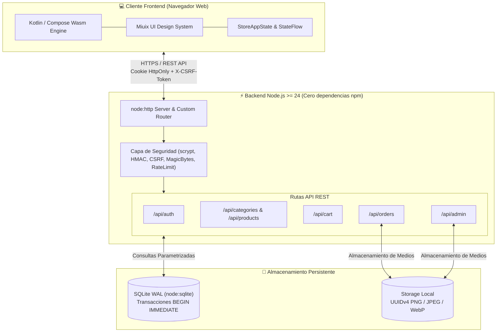
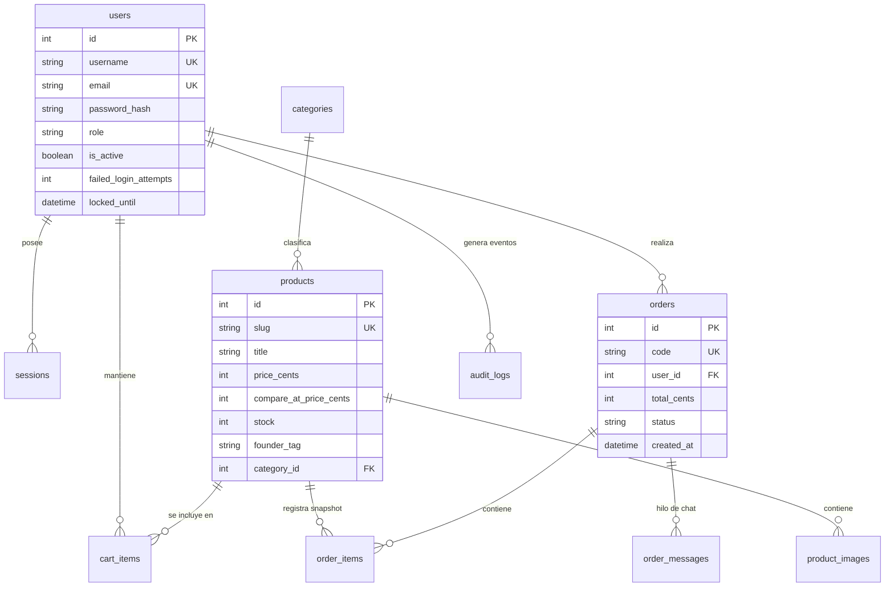

# TBD.SUPPLY ⚡

**Hardware, Drip & Objetos con Criterio** — Plataforma e-commerce full-stack de alto rendimiento con interfaz nativa compilada a **WebAssembly (Kotlin 2.4 / Compose Multiplatform + Miuix UI)** y servidor HTTP backend en **Node.js (>= 24) + SQLite WAL** construido con **cero dependencias npm de terceros**.

[](https://github.com/MituOS2/TBD-Supply/actions/workflows/ci.yml)
[](LICENSE)
[](https://nodejs.org/)
[](https://kotlinlang.org/docs/wasm-overview.html)
[](https://nodejs.org/api/sqlite.html)
[](#-stack-tecnológico)
[](https://github.com/compose-miuix-ui/miuix)

> 💡 **Proyecto de Ingeniería de Software** desarrollado y presentado por **Enrique**, **Edgarvis**, **Leonel**, **Aníbal** y **Jhoynner**.

---

## 📌 Tabla de Contenidos

- [Visión General](#-visión-general)
- [Características Destacadas](#-características-destacadas)
  - [Experiencia del Cliente (Storefront Wasm)](#experiencia-del-cliente-storefront-wasm)
  - [Panel de Administración Operativo](#panel-de-administración-operativo)
  - [Seguridad de Nivel Empresarial desde Cero](#seguridad-de-nivel-empresarial-desde-cero)
- [Arquitectura del Sistema](#-arquitectura-del-sistema)
- [Stack Tecnológico](#-stack-tecnológico)
- [Estructura del Proyecto](#-estructura-del-proyecto)
- [Guía de Inicio Rápido (Lanzadores 1-Clic)](#-guía-de-inicio-rápido-lanzadores-1-clic)
  - [Requisitos Previos](#requisitos-previos)
  - [Windows (`iniciar.bat` / `iniciar-publico.bat`)](#windows-iniciarbat--iniciar-publicobat)
  - [Linux / macOS (`iniciar.sh`)](#linux--macos-iniciarsh)
  - [Banderas y Opciones CLI](#banderas-y-opciones-cli)
- [Desarrollo Manual & Scripts `npm`](#-desarrollo-manual--scripts-npm)
- [Configuración & Variables de Entorno](#-configuración--variables-de-entorno)
- [Referencia de API REST](#-referencia-de-api-rest)
- [Modelo de Datos & Esquema SQLite](#-modelo-de-datos--esquema-sqlite)
- [Pruebas Automatizadas & CI/CD](#-pruebas-automatizadas--cicd)
- [Gobernanza & Estándar de Commits](#-gobernanza--estándar-de-commits)
- [Licencia & Créditos](#-licencia--créditos)

---

## 🚀 Visión General

**TBD.SUPPLY** es una plataforma moderna de comercio electrónico full-stack diseñada para ofrecer una experiencia fluida, rápida y segura tanto para compradores como para administradores. 

Combinando la potencia de **Kotlin/Compose Multiplatform compilado a WebAssembly (`wasmJs`)** en el cliente y un servidor HTTP en **Node.js 24 puro** (utilizando el nuevo motor `node:sqlite` nativo y módulos sin librerías externas de terceros), TBD.SUPPLY demuestra que es posible construir una aplicación web completa, segura y escalable con huella mínima y cero vulnerabilidades de cadena de suministro (*zero npm dependencies*).

---

## ✨ Características Destacadas

### Experiencia del Cliente (Storefront Wasm)
- 🎨 **Diseño Nativo con Miuix UI:** Renderizado ultra-fluido mediante Kotlin Compose Multiplatform (`wasmJs` + Skiko) utilizando el sistema de diseño [Miuix](https://github.com/compose-miuix-ui/miuix).
- 📱 **Layout Adaptable Inteligente:** Transición fluida entre barra de navegación inferior (`NavigationBar` para pantallas `< 840 dp`) y riel lateral expandible (`NavigationRail` para pantallas `>= 1180 dp`).
- 🌈 **Personalización de Temas:** Conmutación dinámica entre 6 temas visuales (`System`, `Light`, `Dark`, `MonetSystem`, `MonetLight`, `MonetDark`), paleta de color clave y bordes en curva *Squircle*.
- 🔍 **Catálogo Dinámico & Filtros:** Búsqueda en tiempo real con sanitización de caracteres comodín, filtrado por categorías y curadores (`Enrique`, `Edgarvis`, `Leonel`, `Aníbal`), ordenamiento multi-criterio y vista detallada con galería fotográfica.
- 🛒 **Carrito & Checkout Atómico:** Carrito persistente con fusión automática tras inicio de sesión (`/api/cart/merge`), cálculo preciso en centavos USD y emisión instantánea de comprobante con código único (`TBD-YYYY-XXXXXX`).
- 💬 **Soporte & Chat por Pedido:** Hilo interactivo de mensajería entre comprador y administrador integrado en cada orden, con soporte para mensajes de texto y adjuntos de imagen validados (`PNG`, `JPEG`, `WebP`).

### Panel de Administración Operativo
- 📊 **Dashboard Métrico:** Indicadores clave en tiempo real sobre ventas, volumen de productos, pedidos pendientes y usuarios activos.
- 📦 **Gestión CRUD de Productos:** Publicación y actualización de artículos con título, subtítulo, precio, precio tachado (oferta), inventario y asignación de curador.
- 🖼️ **Galería Multimedia:** Carga de imágenes con previsualización, asignación de foto de portada principal y eliminación segura.
- 📂 **Control de Categorías:** Creación y edición de categorías con código de color hexadecimal, descripción y orden de visualización.
- 🚚 **Gestión de Órdenes:** Transición de estados de pedidos (`Pendiente` ➔ `Preparando` ➔ `Enviado` ➔ `Entregado` / `Cancelado`) y atención directa por chat.
- 🛡️ **Administración de Usuarios & Auditoría:** Consulta de usuarios, gestión de roles (`customer` / `admin`), revocación remota de sesiones y bitácora inmutable de eventos (`audit_logs`).

### Seguridad de Nivel Empresarial desde Cero
- 🔑 **Derivación de Claves con `scrypt`:** Derivación robusta (`N=16384`, `r=8`, `p=1`) con salt aleatorio de 16 bytes y comparación en tiempo constante (`crypto.timingSafeEqual`).
- 🍪 **Sesiones Opacas HMAC-SHA256:** Token de 256 bits almacenado en cookie `tbd_sid` (`HttpOnly; SameSite=Strict; Secure`). En SQLite se almacena únicamente el hash HMAC con `SESSION_PEPPER`.
- 🛡️ **Doble Protección Anti-CSRF:** Verificación estricta de `Sec-Fetch-Site` / `Origin` / `Referer` combinada con token `X-CSRF-Token` en cabeceras.
- 🖼️ **Inspección de Archivos por Magic Bytes:** Parser multipart propio que analiza los encabezados binarios reales (`PNG`, `JPEG`, `WebP`). Bloqueo estricto de `SVG` contra ataques Stored XSS.
- 🚫 **Mitigación OWASP:** Protección contra SQL Injection (consultas parametrizadas SQLite), Path Traversal, Prototype Pollution (`Object.create(null)`), IDOR, y Rate Limiting por ventana deslizante.

---

## 🏗️ Arquitectura del Sistema



---

## 🛠️ Stack Tecnológico

| Capa | Tecnología / Componente | Descripción & Rol |
| :--- | :--- | :--- |
| **Frontend UI** | Kotlin `2.4.21` + Compose Wasm `1.12.2` | Compilación nativa WebAssembly (`wasmJs` + Skiko canvas) |
| **Diseño UI** | [Miuix UI](https://github.com/compose-miuix-ui/miuix) (`vendor/miuix`) | Sistema de componentes fluido estilo Android/Xiaomi integrado vía Gradle Composite Build |
| **Backend Core** | Node.js `>= 24.0.0` (ESM) | Servidor HTTP en arquitectura modular usando **exclusivamente módulos nativos** |
| **Base de Datos** | SQLite Nativo (`node:sqlite`) | Motor embebido en modo `WAL`, `PRAGMA foreign_keys = ON` y transacciones `BEGIN IMMEDIATE` |
| **Criptografía** | `node:crypto` | Hashes `scrypt`, HMAC-SHA256, salting de IP y generación de tokens de 256 bits |
| **Testing** | `node:test` + `node:assert/strict` | Suites de integración end-to-end y auditoría de vectores de seguridad |
| **CI / CD** | GitHub Actions | Integración continua en Node.js 24 para comprobación de tests en cada PR / Commit |

---

## 📁 Estructura del Proyecto

```text
TBD-Supply/
├── .github/
│   ├── ISSUE_TEMPLATE/          # Plantillas YAML para reporte de bugs y sugerencias
│   ├── workflows/ci.yml         # Workflow de GitHub Actions para CI (npm test)
│   └── PULL_REQUEST_TEMPLATE.md # Plantilla estructurada para Pull Requests
├── gradle/
│   ├── libs.versions.toml       # Catálogo unificado de dependencias Kotlin/Compose
│   └── wrapper/                 # Gradle Wrapper ejecutable (8.14)
├── scripts/
│   ├── bootstrap.ps1            # Script de aprovisionamiento y build para PowerShell
│   ├── bootstrap.sh             # Script de aprovisionamiento y build para Bash/Zsh
│   └── seed-assets/             # Catálogo de imágenes PNG semilla para demo
├── server/
│   ├── data/                    # Almacenamiento de base de datos SQLite (store.sqlite)
│   ├── storage/uploads/         # Almacenamiento local de medios subidos
│   ├── dist-web/                # Distribución compilada del frontend WebAssembly
│   ├── src/
│   │   ├── db/                  # Esquema, migraciones WAL, conexión y semilla
│   │   ├── http/                # Servidor HTTP nativo, router y helpers de respuesta
│   │   ├── middleware/          # Autenticación de sesión, validación CSRF y RBAC
│   │   ├── routes/              # Módulos de rutas API (auth, store, cart, orders, admin)
│   │   ├── security/            # Algoritmos scrypt, HMAC, saneamiento, magic bytes, rate limit
│   │   ├── utils/               # Bitácora de auditoría (audit_logs) y anonimización de IP
│   │   ├── app.js               # Ensamblado del servidor HTTP y entrega estática SPA
│   │   ├── config.js            # Carga y validación de variables de entorno
│   │   └── index.js             # Punto de entrada y manejo de señales de apagado
│   └── tests/
│       ├── integration.test.js  # Pruebas integrales de flujo completo cliente/servidor
│       └── security.test.js     # Batería de pruebas contra vulnerabilidades OWASP
├── webApp/
│   └── src/
│       ├── commonMain/kotlin/nose/
│       │   ├── model/           # DTOs y modelos de datos serializables JSON
│       │   ├── network/         # Cliente HTTP y abstracción de plataforma
│       │   ├── state/           # Gestor de estado reactivo (StoreAppState)
│       │   ├── ui/components/   # Tarjetas de productos, diálogos, chat y componentes Miuix
│       │   ├── ui/screens/      # Pantallas principales (Store, Cart, Account, Orders, Admin)
│       │   └── App.kt           # Punto de entrada UI Compose y ruteo dinámico
│       └── webMain/             # Bootstrap WebAssembly y recursos web (index.html, CSS)
├── .editorconfig                # Reglas de estilo de código universales
├── .env.example                 # Plantilla con todas las variables de entorno soportadas
├── AGENTS.md                    # Instrucciones y restricciones para Agentes de IA
├── CHANGELOG.md                 # Historial de cambios siguiendo Keep a Changelog
├── CONTRIBUTING.md              # Guía de contribución y especificación Conventional Commits
├── LICENSE                      # Licencia de código abierto MIT
├── SECURITY.md                  # Política de seguridad y guía de endurecimiento
├── iniciar.bat                  # Lanzador automatizado 1-clic para Windows
├── iniciar-publico.bat          # Lanzador Windows con túnel público Cloudflare
└── iniciar.sh                   # Lanzador automatizado 1-clic para Linux / macOS
```

---

## ⚡ Guía de Inicio Rápido (Lanzadores 1-Clic)

### Requisitos Previos
Los scripts de arranque detectan e instalan automáticamente las dependencias faltantes cuando es posible. Se recomienda contar con:
- **Node.js `>= 24.0.0`** (con soporte nativo `node:sqlite`).
- **JDK `21+`** (necesario para compilar el frontend Kotlin Compose Wasm).
- **Git** (para clonar el submodulo de UI `vendor/miuix`).

### Windows (`iniciar.bat` / `iniciar-publico.bat`)

Para iniciar la aplicación localmente en Windows, simplemente haz doble clic en **`iniciar.bat`** o ejecútalo desde PowerShell/CMD:

```cmd
iniciar.bat
```

El lanzador se encargará automáticamente de:
1. Validar la presencia de Node.js 24, Java 21 y Git (instalándolos vía `winget` si no están presentes).
2. Clonar el repositorio del motor de UI [Miuix](https://github.com/compose-miuix-ui/miuix) en `vendor/miuix` (`commit d8efe187`).
3. Generar el archivo `.env` local con secretos criptográficos únicos de 32 bytes (`SESSION_PEPPER`, `IP_HASH_SALT`).
4. Compilar el paquete WebAssembly de Kotlin/Compose y guardarlo en `server/dist-web/`.
5. Ejecutar migraciones de la base de datos SQLite, sembrar datos iniciales y levantar el servidor HTTP en `http://127.0.0.1:3000`.

Para compartir tu instancia local en internet de forma segura mediante **Cloudflare Quick Tunnel**:
```cmd
iniciar-publico.bat
```

### Linux / macOS (`iniciar.sh`)

Otorga permisos de ejecución e inicia la app:

```bash
chmod +x iniciar.sh scripts/bootstrap.sh
./iniciar.sh
```

### Banderas y Opciones CLI

Tanto `iniciar.bat` como `iniciar.sh` aceptan parámetros opcionales para personalizar el proceso de inicio:

| Opción Windows | Opción Linux / macOS | Descripción |
| :--- | :--- | :--- |
| `-Tunnel` | `--tunnel` | Expone la app local mediante un túnel público seguro de Cloudflare (`https://*.trycloudflare.com`). |
| `-Rebuild` | `--rebuild` | Fuerza una recompilación limpia del frontend WebAssembly pasando de la caché. |
| `-BuildOnly` | `--build-only` | Verifica las dependencias y compila el frontend Wasm sin iniciar el servidor HTTP. |
| `-CheckOnly` | `--check-only` | Verifica únicamente la compatibilidad del entorno (Node, Java, Git, Miuix). |
| `-NoBrowser` | `--no-browser` | Inicia el servidor HTTP sin abrir automáticamente la ventana del navegador. |

---

## 💻 Desarrollo Manual & Scripts `npm`

Si prefieres realizar el desarrollo manualmente paso a paso sin utilizar los lanzadores automáticos:

```bash
# 1. Copiar plantilla de variables de entorno
cp .env.example .env

# 2. Sembrar la base de datos SQLite e inicializar el usuario Admin
npm run seed

# 3. Compilar el frontend WebAssembly (asegurando vendor/miuix presente)
./gradlew :webApp:wasmJsBrowserDistribution -Prelease --no-configure-on-demand
cp -R webApp/build/dist/wasmJs/productionExecutable/. server/dist-web/

# 4. Iniciar el servidor backend en modo desarrollo con recarga en vivo
npm run dev
```

### Scripts `npm` Disponibles

| Script | Comando | Descripción |
| :--- | :--- | :--- |
| `npm start` | `node server/src/index.js` | Inicia el servidor HTTP en modo producción. |
| `npm run dev` | `node --watch server/src/index.js` | Inicia el servidor HTTP en modo desarrollo con reinicio automático al guardar cambios. |
| `npm run seed` | `node server/src/db/runSeed.js` | Ejecuta migraciones e inserta el usuario administrador por defecto y catálogo semilla. |
| `npm test` | `node --test server/tests/integration.test.js server/tests/security.test.js` | Ejecuta toda la suite de pruebas automatizadas (integración + seguridad). |
| `npm run test:security` | `node --test server/tests/security.test.js` | Ejecuta exclusivamente la suite de auditoría de seguridad. |

---

## ⚙️ Configuración & Variables de Entorno

El servidor lee la configuración desde el archivo `.env` o desde las variables de entorno del sistema operativo:

| Variable | Valor por Defecto | Descripción |
| :--- | :--- | :--- |
| `PORT` | `3000` | Puerto en el que escuchará el servidor HTTP (`1–65535`). |
| `HOST` | `127.0.0.1` | Dirección IP de la interfaz de red (`127.0.0.1` o `0.0.0.0`). |
| `NODE_ENV` | `development` | Entorno de ejecución (`development` o `production`). |
| `DB_PATH` | `server/data/store.sqlite` | Ruta del archivo de base de datos SQLite. |
| `UPLOAD_DIR` | `server/storage/uploads` | Carpeta de almacenamiento para imágenes subidas. |
| `DIST_WEB_DIR` | `server/dist-web` | Carpeta contenedora del paquete WebAssembly compilado. |
| `SESSION_PEPPER` | *(Autogenerado)* | Secreto HMAC de 32 bytes hexadecimales para hashear tokens de sesión. |
| `IP_HASH_SALT` | *(Autogenerado)* | Sal criptográfica para la anonimización de direcciones IP en logs de auditoría. |
| `ADMIN_BOOTSTRAP_USER` | `admin` | Usuario administrador inicial predeterminado. |
| `ADMIN_BOOTSTRAP_EMAIL` | `admin@tbdsupply.local` | Correo del usuario administrador inicial. |
| `ADMIN_BOOTSTRAP_PASSWORD` | *(Autogenerado)* | Contraseña del administrador inicial (generada efímeramente si no se define). |
| `ALLOWED_ORIGINS` | `""` | Orígenes adicionales autorizados para la validación CSRF/Same-Origin (separados por coma). |
| `TRUST_PROXY` | `false` | Habilitar (`true`) cuando el servidor opera detrás de un Reverse Proxy (Nginx, Cloudflare). |
| `COOKIE_SECURE` | `false` | Enviar cookie de sesión con atributo `Secure` (forzado en `production`). |
| `LOCAL_AUTO_ADMIN` | `true` | Iniciar sesión admin automáticamente en conexiones `localhost`. **Establecer en `false` en producción.** |
| `SEED_DEMO_CATALOG` | `false` | Cargar automáticamente los 12 productos demo e imágenes PNG al inicializar la BD. |

---

## 📡 Referencia de API REST

Todos los endpoints que modifican estado (`POST`, `PUT`, `PATCH`, `DELETE`) requieren la cabecera `X-CSRF-Token` y comprobación de origen.

### 🟢 Salud & Público
- `GET /api/health` — Comprobación de estado del servidor (`{ "ok": true }`).
- `GET /api/categories` — Listado de categorías activas y conteo de productos.
- `GET /api/products` — Catálogo paginado con parámetros `q`, `category`, `founder`, `sort`, `page`, `limit`.
- `GET /api/products/:slug` — Obtener detalle de producto por su slug y galería de imágenes.
- `GET /api/media/:key` — Entrega segura de imágenes de productos validadas con sandbox CSP.

### 🔑 Autenticación & Usuarios
- `GET /api/auth/me` — Devuelve los datos del usuario autenticado actual y el token CSRF activo.
- `POST /api/auth/register` — Registro de nueva cuenta cliente (`customer`) e inicio de sesión automático.
- `POST /api/auth/login` — Inicio de sesión con usuario/correo y contraseña (protegido con rate limit).
- `POST /api/auth/logout` — Cierra la sesión activa actual y limpia la cookie `tbd_sid`.
- `POST /api/auth/logout-all` — Revoca todas las sesiones activas del usuario en todos los dispositivos.
- `POST /api/auth/change-password` — Cambio de contraseña con actualización de hash y renovación de sesión.

### 🛒 Carrito & Compras
- `GET /api/cart` — Obtiene el carrito del usuario activo con cálculo de subtotal y stock.
- `PUT /api/cart/items/:productId` — Agrega, modifica o elimina (`quantity: 0`) un producto del carrito.
- `POST /api/cart/merge` — Sincroniza e integra los ítems del carrito anónimo previo al iniciar sesión.
- `POST /api/checkout` — Procesa la compra en una transacción atómica `BEGIN IMMEDIATE`, descuenta inventario y genera la orden.

### 💬 Órdenes & Chat Integrado
- `GET /api/orders` — Obtener el historial de compras del cliente autenticado.
- `GET /api/orders/:orderCode` — Obtener el detalle completo de una orden, artículos y chat.
- `GET /api/orders/:orderCode/messages` — Listar los mensajes del hilo de conversación del pedido.
- `POST /api/orders/:orderCode/messages` — Enviar mensaje de texto o adjunto de imagen (`multipart/form-data`).
- `GET /api/orders/:orderCode/attachments/:key` — Descarga segura de adjuntos del chat de pedido.

### 🛡️ Panel de Administración (`/api/admin/*` — Requiere rol `admin`)
- `GET /api/admin/dashboard` — Métricas generales de la tienda (ingresos, inventarios, usuarios, órdenes).
- `GET/POST/PATCH/DELETE /api/admin/categories` — CRUD completo de categorías.
- `GET/POST/PATCH/DELETE /api/admin/products` — CRUD completo de productos del catálogo.
- `POST/PATCH/DELETE /api/admin/media` — Carga de imágenes, selección de imagen principal y borrado.
- `GET/PATCH/DELETE /api/admin/orders` — Listado de pedidos, actualización de estado y cancelación.
- `GET/PATCH/DELETE /api/admin/users` — Gestión de usuarios, cambio de roles y revocación de sesiones.
- `GET /api/admin/audit-logs` — Consulta de la bitácora de auditoría del sistema.

---

## 🗄️ Modelo de Datos & Esquema SQLite

SQLite opera en modo **WAL (Write-Ahead Logging)** con claves foráneas activadas (`PRAGMA foreign_keys = ON`). El esquema consta de 10 tablas relacionales optimizadas:



---

## 🧪 Pruebas Automatizadas & CI/CD

El proyecto cuenta con una suite completa de pruebas ejecutable mediante el motor nativo `node:test`:

```bash
# Ejecutar todas las pruebas (integración + auditoría de seguridad)
npm test

# Ejecutar únicamente las pruebas de seguridad
npm run test:security
```

### Cobertura de Pruebas Integradas:
1. **Pruebas de Integración (`integration.test.js`):**
   - Verificación de endpoints de salud y entrega estática WebAssembly.
   - Registro, autenticación, revocación y expiración de sesiones.
   - Sincronización de carrito invitado/registrado y validación de precios en centavos USD.
   - Flujo atómico de checkout con reserva de inventario y generación de comprobante.
   - Chat interactivo por pedido con subida y desacople de adjuntos de imagen.
   - Operaciones CRUD completas desde el panel de administración.
2. **Pruebas de Seguridad (`security.test.js`):**
   - Sanitización contra inyecciones SQL en parámetros de ordenamiento y búsqueda.
   - Validación de tokens CSRF y rechazo de orígenes no autorizados.
   - Verificación de límites de rate limiting y bloqueo de IP por fuerza bruta.
   - Inspección binaria de Magic Bytes y bloqueo de carga de archivos `SVG` (Anti-XSS).
   - Verificación de aislamiento de datos IDOR entre usuarios en pedidos y adjuntos.
   - Protección contra condiciones de carrera (*race condition*) en descontado de stock concurrente.

---

## 🤝 Gobernanza & Estándar de Commits

Aceptamos contribuciones de la comunidad. Para mantener un historial de control de versiones limpio y legible, seguimos la especificación [Conventional Commits 1.0.0](https://www.conventionalcommits.org/es/v1.0.0/):

```text
<tipo>(<alcance>): <descripción breve en imperativo>

[cuerpo descriptivo opcional]

[pie de página opcional]
```

### Tipos Permitidos:
- `feat`: Nueva funcionalidad en frontend, backend o scripts.
- `fix`: Corrección de errores de lógica o seguridad.
- `docs`: Cambios en la documentación (`README.md`, `SECURITY.md`, etc.).
- `style`: Formateo de código sin alteración de comportamiento.
- `refactor`: Reestructuración interna de código.
- `perf`: Optimización de rendimiento.
- `test`: Adición o actualización de pruebas automatizadas.
- `build`: Cambios en Gradle, WebAssembly o empaquetado.
- `ci`: Modificaciones en workflows de GitHub Actions.
- `chore`: Tareas de mantenimiento o archivos de configuración.

Consulta la guía completa en [CONTRIBUTING.md](CONTRIBUTING.md).

---

## 📜 Licencia & Créditos

Este proyecto se distribuye bajo la licencia **MIT**. Consulta el archivo [LICENSE](LICENSE) para más información.

**TBD.SUPPLY** fue diseñado y desarrollado con dedicación por:
- **Enrique**
- **Edgarvis**
- **Leonel**
- **Aníbal**
- **Jhoynner**

---
*© 2026 TBD.SUPPLY — Hardware, Drip & Objetos con Criterio.*
